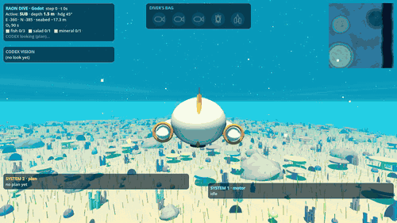
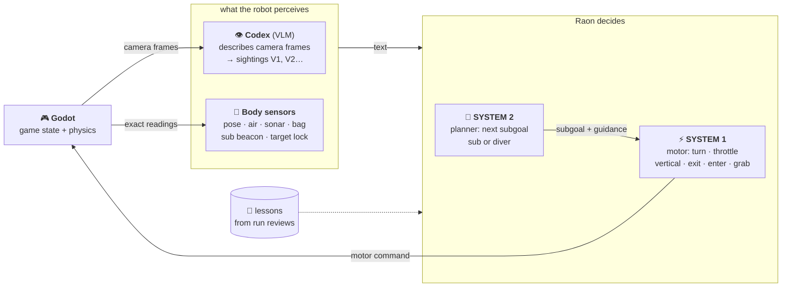

# Raonautica

A submarine and a diver explore a 1 km Subnautica-style ocean, built in [Godot 4](https://godotengine.org), to gather lunch:
3 fish, 1 sea lettuce and 1 salt crystal. **No human or scripted AI plays.** [Codex](https://github.com/openai/codex) looks
at the game and [Raon](https://raon.krafton.ai), [KRAFTON](https://huggingface.co/KRAFTON)'s model family, decides every move. The LLM used here is
`raon-1-mini-preview`, a text-only, OpenAI-compatible chat API.



## How it works



1. **Game state:** Godot simulates the world and serves a TCP bridge. It renders the active body's cameras on request.
2. **VLM (Codex):** describes the frames as strict JSON. It detects targets, then confirms them on zoomed crops. Sightings (V1, V2…) are remembered with estimated positions.
3. **SYSTEM 2 (Raon):** the slow planner. It runs on events (start, grab, low air, stuck, new sightings) and picks the next subgoal and body.
4. **SYSTEM 1 (Raon):** the fast controller. Each step it outputs one motor command for the sub or the diver.

The sub is fast but can't grab anything, and it doesn't fit into the kelp forest or the crevice. The diver
is slow and has 90 s of air. Grabbed items go straight into the diver's bag.

Runs are reviewed afterwards from their screenshots and logs. The lessons from each review go into
`feedback/lessons-godot.md`, which is hot-reloaded into both Raon prompts.

## Run it

Requirements: [Godot 4.x](https://godotengine.org/download), [Node 20+](https://nodejs.org), the [Codex CLI](https://github.com/openai/codex), [ffmpeg](https://ffmpeg.org), and a Raon API key in `.env` (`RAON_API_KEY=...`, optional `RAON_BASE_URL`).

```bash
npm install
node harness-godot/run.js --steps 250 --speed 4            # opens the Godot window; just watch
node harness-godot/run.js --record                         # also saves gameplay frames to runs/<id>/frames
node harness-godot/preview.js                              # visual check, no Raon/Codex
node harness-godot/visual-qa.js                            # Codex critiques short clips of key scenes
```

Each run writes `runs/<id>/`: `log.jsonl` (every prompt, reply and result), `shots/`, `vlm/` (what Codex saw) and `summary.json`.

## Layout

| path | what |
|---|---|
| `godot/` | world, sub and diver, simulation, HUD, TCP bridge |
| `harness-godot/` | run loop, Codex VLM, Raon client, prompts |
| `feedback/` | lessons distilled from run reviews |
| `web/`, `server.js`, `harness.js` | the earlier three.js version (Raon sees a text description, no VLM): `npm run serve` |
